# TripFlow — 발견에서 여행 티켓까지

<p align="center"></p>

**여행지를 찾고, 후보를 모으고, 방문 순서를 연결해 나만의 여행 티켓으로 남기는 국내 여행 서비스입니다.**

어디로 갈지 고민될 때는 지도에 공을 던지는 **Trip Shot**, 가고 싶은 곳이 있다면 **블록 코스 만들기**로 시작합니다. 만든 코스는 저장·복사·수정하고 여행 후기와 함께 공유할 수 있습니다.

> 현재 버전은 프론트엔드 중심 구현입니다. 관광정보 실연동 경로는 제공하지만 회원·코스·게시판 저장은 브라우저 내부에서 동작합니다. 아래 실행 화면은 **2026-10-02 샘플 모드**에서 촬영했으며 실제 사용자 정보나 실 API 응답을 포함하지 않습니다.

## 미리보기


| 장소를 발견하고 | 코스를 연결하고 | 티켓으로 간직하기 |
|---|---|---|
| 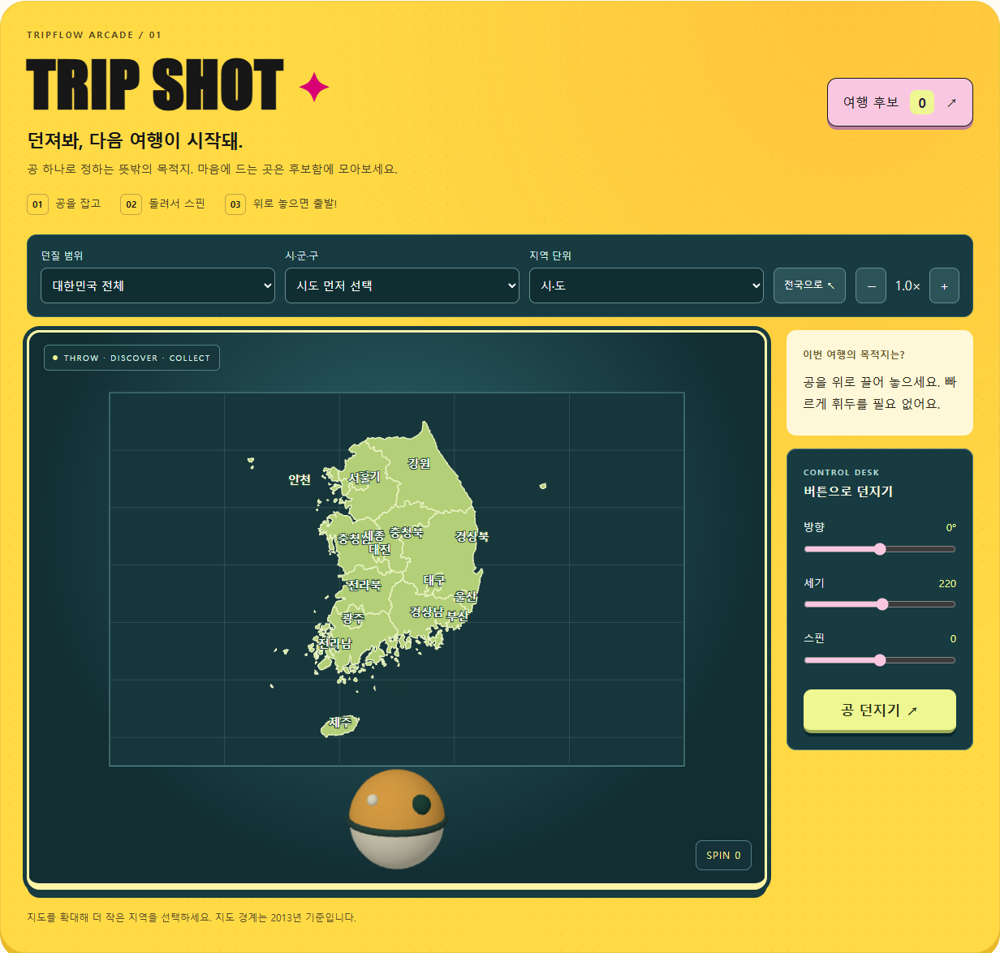 | 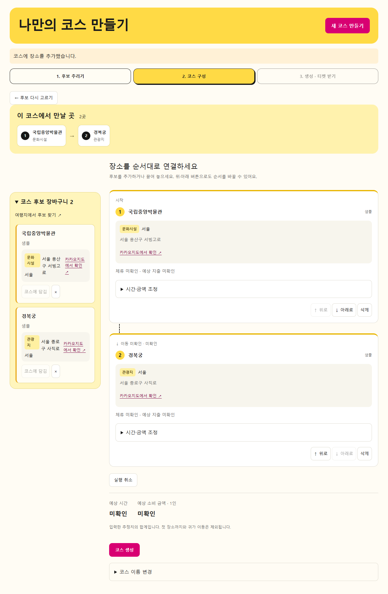 | 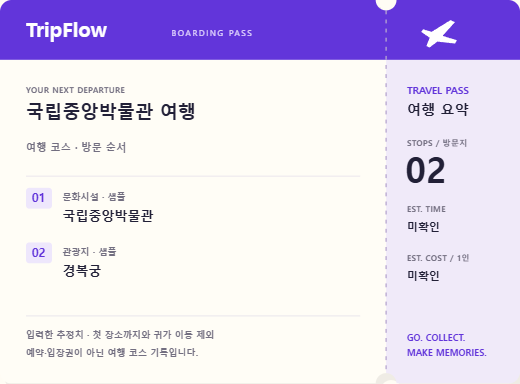 |
| 지도에 공을 던져 여행 후보 발견 | 장소 블록을 원하는 순서로 배치 | 코스 생성 후 PNG 다운로드 |

## 요구사항별 목차

과제의 F 번호를 유지했습니다. RND·CB·MAP·UIA는 서비스 확장 요구사항이며, 미구현 항목에는 실행 화면을 제시하지 않습니다.

| 번호 | 요구사항 / 화면 | 현재 범위 |
|---|---|---|
| [F101](#f101) | 지역별 관광정보 수집·지도 탐색 | 샘플 조회 및 TourAPI 서버 경유 연동 |
| [F102](#f102) | 관광지·숙박·음식점 조회 | 지역·유형·검색어 필터 |
| [F103](#f103) | 문화시설·축제·여행코스·레포츠·쇼핑 조회 | 콘텐츠 유형 및 세부 분류 |
| [F104](#f104) | 여행계획과 코스 관리 | 후보 → 블록 구성 → 생성 → 티켓 저장 |
| [F105](#f105) | Hotplace 등록 | 미구현 |
| [F106](#f106) | 관광 뉴스 크롤링 | 미구현 |
| [F107](#f107) | 회원가입·조회·수정·탈퇴 | 합성 계정용 로컬 회원 기능 |
| [F108](#f108) | 로그인·로그아웃·비밀번호 찾기 | 로컬 세션·복구 코드 재설정 |
| [F109](#f109) | 공지사항 관리 | 미구현 |
| [F110](#f110) | 여행 공유게시판 | 작성·조회·수정·삭제·코스 첨부 |
| [F111~F114](#f111-f114) | 날씨·추천 사진·일출일몰·충전소 | 후속 후보, 미구현 |
| [RND-01~18](#rnd) | 랜덤 여행 Trip Shot | 공 던지기·스핀·전국 지역 후보 저장 |
| [CB-FLOW / CB-TICKET](#ticket) | 통합 제작 흐름·여행 티켓 | 단계 이동·항공권형 PNG |
| [NF102 / UIA](#responsive) | 반응형·화면 깊이·접근성 | 360·768·1440px / 최대 3단계 |

## 요구사항별 실행 화면

<a id="f101"></a>
### F101 — 지역별 관광정보 수집과 지도 탐색

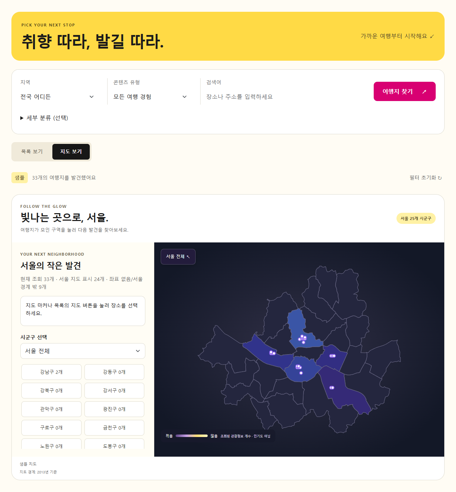

**진입:** 여행지 탐색 → 지도 보기 (`#explore`)

- 지역을 선택하면 지도와 장소 목록을 함께 탐색합니다. 지도에서 선택한 장소는 목록과 연결됩니다.
- 실연동 모드에서는 한국관광공사 국문 관광정보 서비스 GW를 조회하며, 카카오지도 SDK 설정 시 지도·마커를 표시합니다.
- 목록 페이지와 지도 범위 조회를 분리해, 목록의 한 페이지 개수 때문에 지도 전체 결과가 제한되지 않도록 구성했습니다.
- 로딩·조회 실패·빈 결과·부분 조회를 구분합니다. 조회 개수를 인기 점수로 표시하지 않습니다.

**화면 읽기:** 위 캡처는 외부 SDK를 사용하지 않는 샘플 경계 지도입니다. 실제 카카오 지도가 연결된 화면으로 제시한 것이 아닙니다. 전국 지역 선택은 MAP-20, 지도 범위 조회는 MAP-22 확장에 해당합니다.

<a id="f102"></a>
### F102 — 관광지·숙박·음식점 찾기

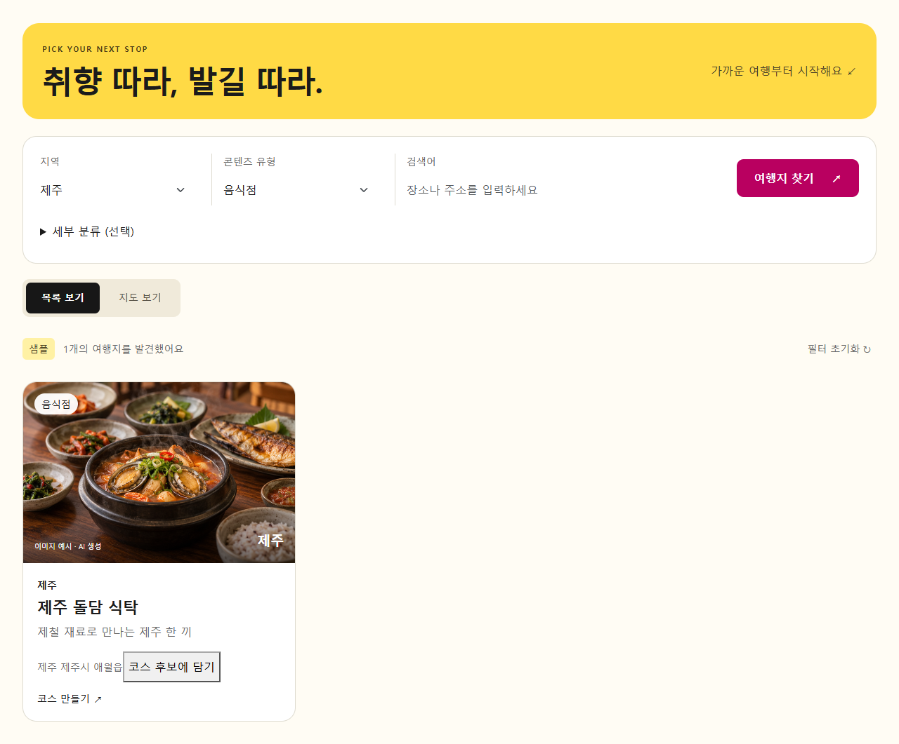

**진입:** 여행지 탐색 → 지역·콘텐츠 유형 선택 → 여행지 찾기

지역, 유형, 검색어를 조합해 장소를 찾습니다. 장소 카드에서 이름·주소·유형을 확인하고 **코스 후보에 담기**로 다음 여행계획에 연결합니다. 같은 장소를 다시 담아도 후보가 중복되지 않습니다.

**화면 읽기:** 제주와 음식점 유형을 선택한 샘플 결과입니다. 운영시간·가격 같은 실제 운영정보를 보장하는 데이터는 아닙니다.

<a id="f103"></a>
### F103 — 문화·축제·쇼핑까지 넓히는 탐색

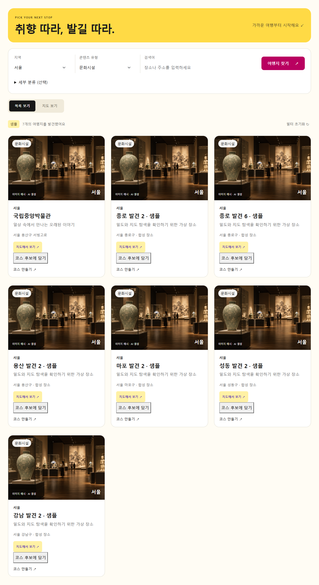

관광지 외에도 문화시설, 공연·축제, 여행코스, 레포츠, 쇼핑을 선택할 수 있습니다. **세부 분류**는 필요한 경우 펼쳐 사용하고, 상위 분류를 바꾸면 하위 조건을 초기화합니다. 관광공사 신분류 코드는 어댑터에서 변환합니다.

**화면 읽기:** 서울 문화시설을 조회한 모습입니다. 샘플 모드의 세부 분류 지원 범위와 실연동 조회는 구분됩니다.

<a id="f104"></a>
### F104 — 후보를 모아 블록으로 만드는 여행 코스

**진입:** 새 코스 만들기 (`#course-editor`)

#### 1. 후보 추리기

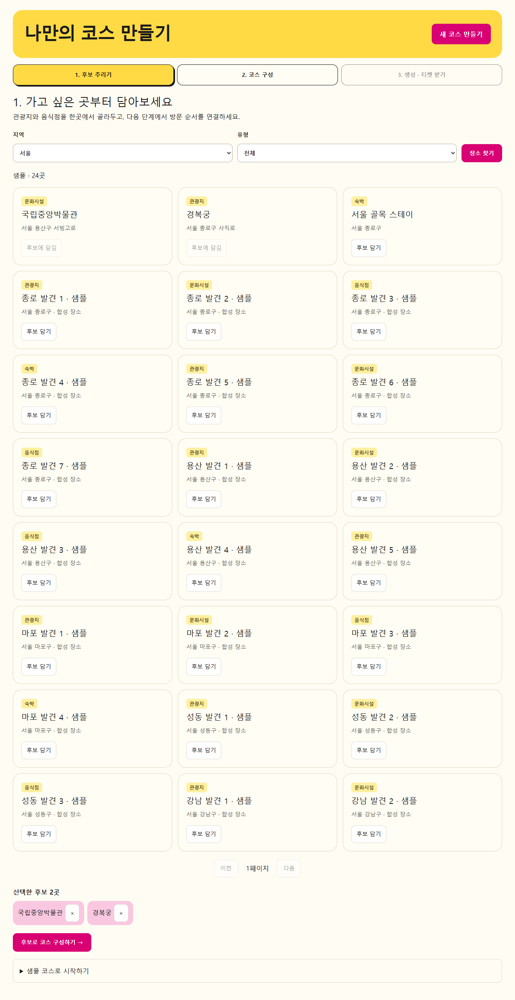

지역·유형별 장소를 같은 화면에서 조회하고 후보함에 담습니다. 여행지 탐색에서 미리 모은 후보도 재사용합니다. 후보는 사용자별 최대 100곳까지 보관합니다.

#### 2. 코스 구성


후보를 코스에 추가하고 드래그 또는 위·아래 버튼으로 방문 순서를 바꿉니다. 장소 유형·주소·지도 링크를 함께 제공해 어떤 장소인지 확인하며 편집할 수 있습니다.

- 코스당 최대 30곳, 삭제·실행 취소 지원
- 장소별 체류 시간·예상 지출과 이전 장소에서 이동하는 시간·비용 조정
- 미입력 값은 **미확인**, 일부만 입력하면 **일부 미확인**으로 표시
- 순서를 바꾸면 출발 장소가 달라진 이동 구간의 추정치 초기화

합계는 사용자가 입력한 추정치이며, 자동 길찾기나 실제 요금 계산이 아닙니다. 첫 장소까지의 이동과 귀가 이동은 제외합니다.

#### 3. 저장한 코스와 다른 코스 활용

| 내 여행 | 코스 둘러보기 |
|---|---|
| 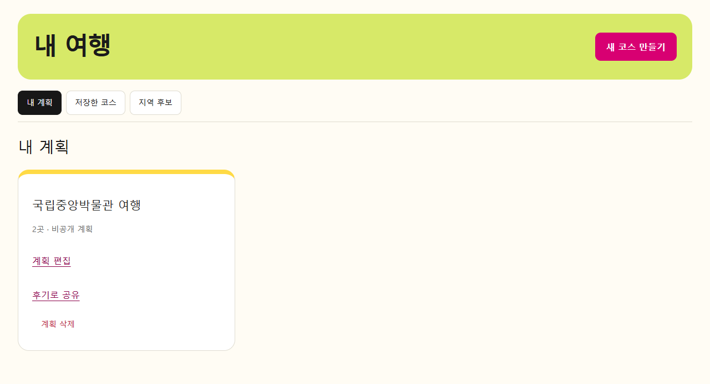 | 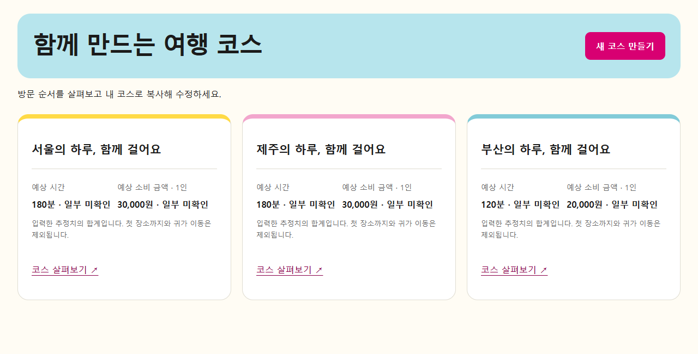 |

저장한 계획을 다시 편집하거나 공유 코스를 **내 일정으로 복사**해 수정합니다. 복사본은 원본과 독립적으로 저장됩니다. 현재 공유·저장은 같은 브라우저의 로컬 데이터 범위이며, 실제 사용자·기기 간 공유 서버는 후속 범위입니다.

<a id="ticket"></a>
### CB-FLOW-01~04 / CB-TICKET-01 — 코스 생성과 항공권형 티켓

<p align="center"></p>

**흐름:** 후보 추리기 → 코스 구성 → 코스 생성 → 티켓 이미지 다운로드

저장이 성공하면 생성 결과에서 티켓 미리보기, PNG 다운로드, 코스 공유, 후기로 공유를 제공합니다. 단계 사이를 오가도 선택한 장소와 순서가 유지되며, 코스를 수정하면 다시 생성한 내용으로 티켓을 받습니다.

티켓에는 **코스명·방문 순서·장소 유형·예상 시간·1인 예상 소비 금액**이 들어갑니다. 항공권처럼 브랜드 헤더, 절취선, 반원 홈, 우측 요약표로 구성했습니다. 방문지가 많거나 이름이 길면 높이를 늘려 정보를 보존합니다. 실제 예약·입장권이 아닌 여행 기록용 이미지입니다.

<a id="f105"></a>
### F105 — Hotplace 등록 · 미구현

사진·위치·방문일을 입력하는 전용 Hotplace 등록 기능은 아직 제공하지 않습니다. 현재 여행 후기 게시판을 이 요구사항의 완료 화면으로 대체하지 않습니다.

<a id="f106"></a>
### F106 — 관광 뉴스 크롤링 · 미구현

뉴스 수집 서버와 전용 화면은 구현하지 않았습니다. 따라서 해당 기능의 실행 캡처는 없습니다.

<a id="f107"></a>
### F107 — 회원가입·내 정보·탈퇴

| 회원가입 | 내 정보 |
|---|---|
| 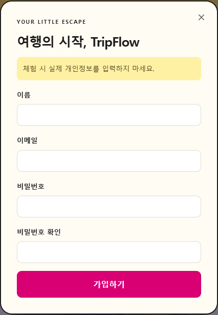 | 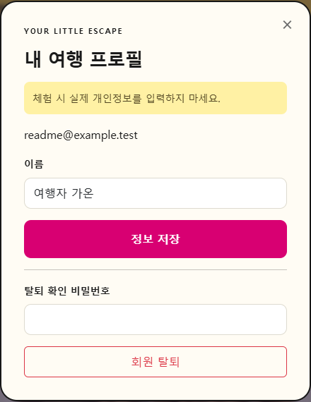 |

**진입:** 상단 회원가입 / 로그인 후 내 정보

이름·이메일·비밀번호 확인을 거쳐 가입하고, 본인의 정보를 조회하거나 이름을 수정합니다. 중복 이메일과 잘못된 입력은 거절하며, 탈퇴에는 비밀번호를 다시 확인합니다.

현재는 **학습용 로컬 회원 기능**입니다. 실제 개인정보를 입력하지 않아야 하며, PBKDF2 해시 저장이 운영 인증·인가를 대신하지 않습니다. 캡처의 계정은 문서용 합성 데이터입니다.

<a id="f108"></a>
### F108 — 로그인·로그아웃·비밀번호 재설정

| 로그인 | 비밀번호 찾기 |
|---|---|
| 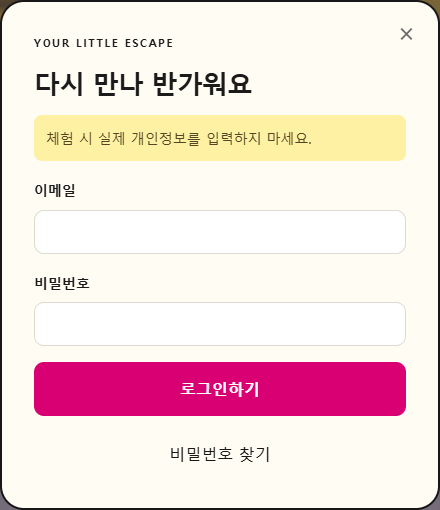 | 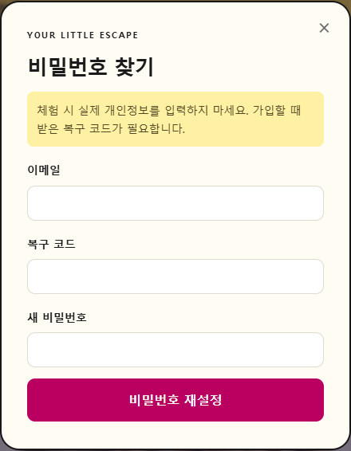 |

로그인 후 탭 세션을 유지하며 로그아웃하면 세션을 제거합니다. 비밀번호 찾기는 가입 시 발급받은 복구 코드로 새 비밀번호를 설정하는 방식입니다. 기존 비밀번호를 그대로 보여주지 않습니다. 이 문서에는 복구 코드와 비밀번호를 캡처하지 않았습니다.

<a id="f109"></a>
### F109 — 공지사항 관리 · 미구현

관리자 공지 등록·수정·삭제와 운영 권한 체계는 후속 범위입니다. 일반 여행 게시판과 별도 요구사항으로 관리합니다.

<a id="f110"></a>
### F110 — 여행 이야기와 코스를 함께 공유하는 게시판

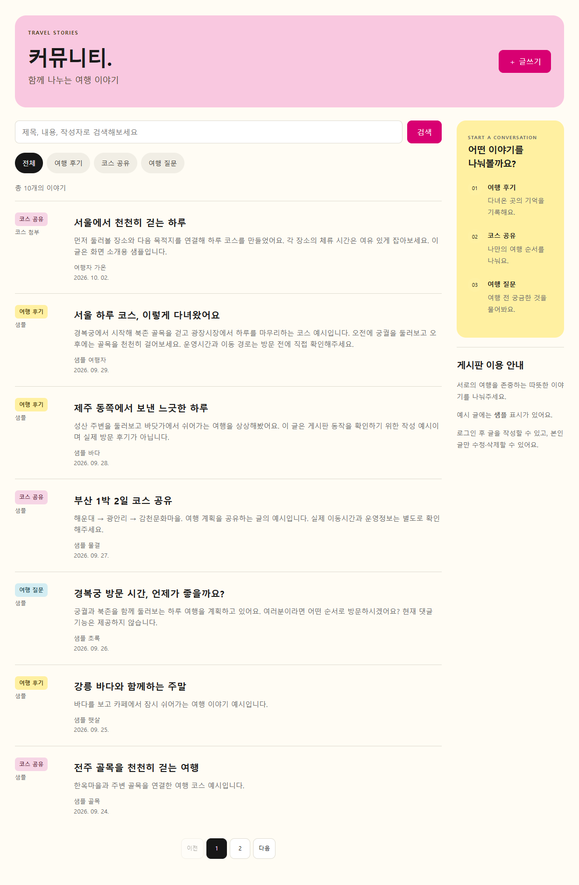

**진입:** 커뮤니티 (`#board`)

여행 후기, 코스 공유, 여행 질문을 분류하고 제목·내용·작성자로 검색합니다. 로그인 후 글을 작성하며 본인 글만 수정·삭제할 수 있습니다. 사진이 없는 글도 제목과 본문 미리보기 중심으로 읽을 수 있게 구성했습니다.

| 코스를 첨부한 글쓰기 | 첨부 코스가 남는 상세 화면 |
|---|---|
| 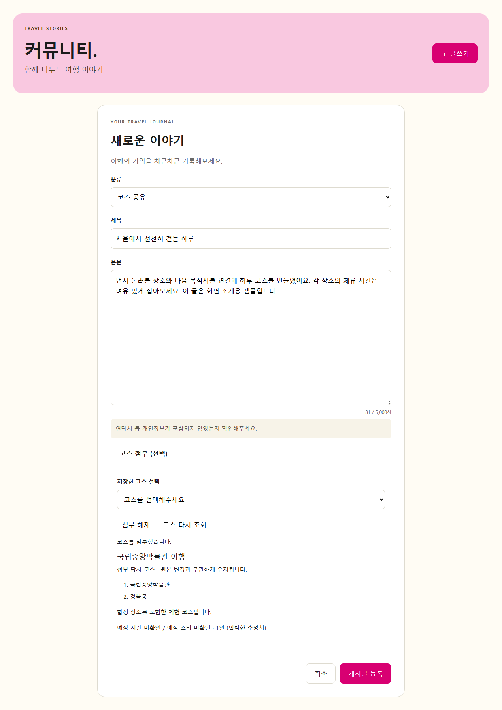 | 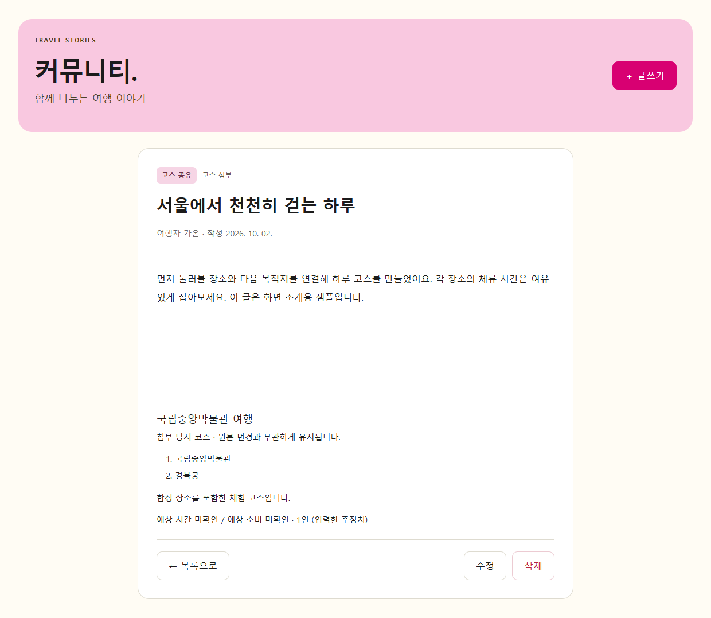 |

완성한 코스에서 **후기로 공유**를 누르면 글쓰기 화면에 장소 순서와 예상 합계를 첨부합니다. 게시글 수정과 새로고침 후에도 첨부 코스가 유지됩니다. 실제 다중 사용자 서버·운영 권한 검증은 아직 제공하지 않습니다.

<a id="f111-f114"></a>
### F111~F114 — 후속 아이디어 · 미구현

날씨, 추천 사진, 일출·일몰, 충전소 기능은 후속 후보로 남겨두었습니다. 화면에 사용하는 분위기 이미지는 추천 사진 서비스 구현을 의미하지 않습니다.

<a id="rnd"></a>
### RND-01~18 — 지도에 공을 던지는 Trip Shot


**진입:** 랜덤 여행 (`#random-trip`)

공을 마우스나 터치로 잡아 돌리고 위로 쓸어 던지면, 맞힌 행정지역을 여행 후보로 담습니다. Three.js의 원근 표현과 cannon-es의 물리를 이용해 멀어질수록 공이 작아지고 스핀은 관성에 따라 점차 느려집니다. 잡기 피드백과 명중 효과를 제공하며 예상 착지점은 표시하지 않습니다.

- 전국 시도 → 시군구 → 읍면동까지 범위 선택
- 버튼·휠·핀치 확대/축소, 더 축소하면 상위 지역으로 복귀
- 키보드 던지기와 모션 감소 설정 지원
- 후보 중복 방지·삭제·실행 취소·새로고침 복원

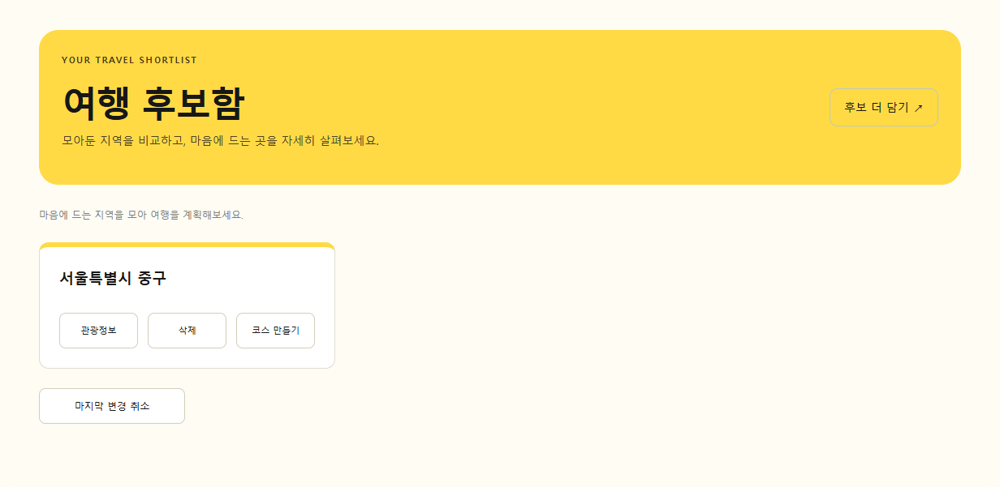

후보함에서 지역 관광정보를 확인하고 코스 만들기로 이어갈 수 있습니다. 행정 경계는 **KOSTAT 2013** 데이터로 최신 경계와 다를 수 있으며, 지역 상세 미리보기는 개별 동네의 전체 관광정보를 보장하지 않습니다.

<a id="responsive"></a>
### NF102 / UIA-01~07 — 작은 화면에서도 이어지는 흐름

<p align="center">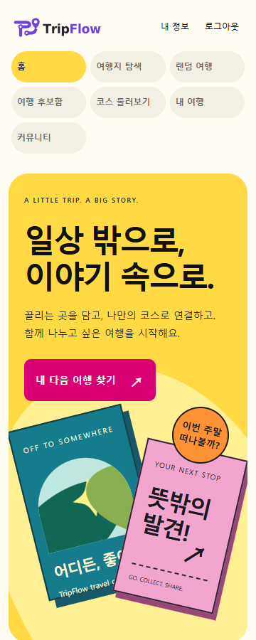</p>

홈 → 기능 → 상세의 최대 3단계로 구성했습니다. 지도 외에도 목록으로 탐색할 수 있고, 드래그 대신 버튼으로 코스를 정렬할 수 있습니다. 360·768·1440px에서 주요 시나리오와 가로 넘침을 검증합니다.

## 서비스의 특징과 차별점

| 설계 방향 | TripFlow에 적용한 방식 | 사용자에게 주는 이점 |
|---|---|---|
| 목적지가 없어도 시작 | 물리 기반 공 던지기와 지역 후보함 | 여행지 선택을 작은 놀이로 시작 |
| 장소 탐색과 계획 연결 | 검색 결과를 같은 후보함에서 재사용 | 장소 정보를 다시 입력할 필요 감소 |
| 입력보다 조합 중심 | 장소 블록과 단계별 제작 화면 | 방문 순서를 눈으로 확인하며 수정 |
| 여행계획을 결과물로 제공 | 항공권형 PNG 티켓 | 완성한 코스를 이미지로 간직 |
| 경험과 계획을 함께 기록 | 후기 본문에 코스 스냅샷 첨부 | 글에서 실제 방문 순서를 함께 확인 |
| 데이터 의미 보존 | 미확인·부분 합계·샘플 표시 | 없는 정보를 0원이나 인기 점수로 오해하지 않음 |

이는 현재 구현한 제품 설계의 특징이며, 경쟁 서비스 대비 성능이나 시장 우위를 측정한 결과는 아닙니다.

## 구조와 기술 스택

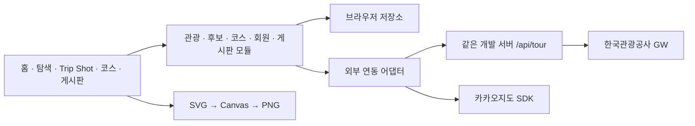

| 영역 | 기술·역할 |
|---|---|
| 화면 | HTML, CSS, JavaScript ES modules, Bootstrap |
| 개발·빌드 | Vite |
| 게임 표현·물리 | Three.js, cannon-es |
| 관광·지도 | 한국관광공사 국문 관광정보 서비스 GW, Kakao Maps 어댑터 |
| 저장 | 브라우저 저장소 기반 회원·후보·코스·게시판 |
| 티켓 | SVG 미리보기, Canvas와 Blob으로 PNG 생성 |
| 검증 | Vitest, jsdom, Playwright |

하나의 앱과 빌드를 유지하는 모듈형 모놀리식입니다. 외부 API·지도 SDK를 어댑터에 격리하고, AI·검색·로그 제공자는 교체 가능한 계약을 둡니다. **실제 AI 추천 서비스는 연결하지 않았습니다.** 기존 적합도·리뷰 계산 코드는 남아 있지만 현재 블록 코스 화면에서 점수·별점을 제공하지 않습니다.

## 로컬 실행

Node.js 22.12 이상 또는 24 LTS가 필요합니다.

```bash
npm ci
npm run dev -- --port 5176 --strictPort
```

[TripFlow 열기](http://127.0.0.1:5176/#home). 기본 실행은 키가 있어도 샘플 모드입니다.

| 실행 모드 | 명령 | 데이터 |
|---|---|---|
| 기본 | `npm run dev` | 샘플 관광정보·경계 지도 |
| 지도 | `npm run dev:map` | 샘플 관광정보·카카오지도 |
| 실연동 | `npm run dev:live` | 관광공사 API·카카오지도 |

포트를 생략하면 기본 5173을 사용합니다. 5176을 사용하려면 각 명령에 `-- --port 5176 --strictPort`를 붙입니다.

실연동 시 `.env`의 `TOUR_API_KEY`에 관광공사 디코딩 키를, `VITE_KAKAO_MAP_APP_KEY`에 공개 JavaScript SDK 키를 설정합니다. 카카오 SDK에는 실제 접속 origin을 등록합니다. 환경파일은 커밋하지 않습니다. 관광 키는 `/api/tour` 서버 경로에서만 사용하며, live 정적 파일만 배포해서는 해당 경로가 제공되지 않습니다. 운영 서버 배포는 별도 작업입니다.

## 검증과 화면 캡처

```bash
npm run rules:check
npm run harness
```

2026-10-02 커밋 `d03fddb` 기준: **단위·DOM 126개, E2E 44개, 빌드 통과**, 규칙 검사 15개 통과. 외부 요청을 차단한 합성 데이터 검증이며 실 API·운영 인증·실제 터치 기기 검증을 대신하지 않습니다. 기존 JSON import·번들 크기 경고는 남아 있습니다.

README 캡처 재생성:

```bash
node scripts/capture-readme.mjs
```

Microsoft Edge가 설치된 환경에서 실행합니다. 스크립트는 **별도 5178 포트의 harness 서버와 새 브라우저 컨텍스트**를 만들고 외부 요청을 차단합니다. 합성 데이터만 사용하며 회원가입 완료의 복구 코드 화면은 촬영하지 않습니다. 캡처는 `docs/screenshots/readme/`에 저장됩니다. 평소 E2E의 자동 스크린샷·영상·트레이스 수집은 계속 비활성화합니다.

## 현재 한계와 후속 범위

- 회원·게시판·코스는 브라우저 저장 기반이며 계정·기기 간 동기화와 운영 권한 경계가 없습니다.
- 예상 시간·금액은 입력값 합계입니다. 실제 경로 계산·영업시간·요금·다일 일정·AI 여행 추천은 후속 범위입니다.
- 지도 SDK와 TourAPI는 키·도메인·호출 한도에 영향을 받습니다. 이 README의 샘플 캡처로 실연동 상태를 증명하지 않습니다.
- 랜덤 여행의 2013년 행정 경계는 최신 행정구역과 다를 수 있습니다.

## 명세와 설계 문서

| 문서 | 내용 |
|---|---|
| [프로젝트 규칙](AGENTS.md) | 명세 우선·테스트·민감정보·변경 원칙 |
| [개발 계획](docs/development-plan.md) | 과제 F 번호와 범위 |
| [테스트 매핑](specs/test-matrix.md) | 요구사항별 검증 근거 |
| [아키텍처](docs/architecture.md) | 모듈 경계와 확장 계약 |
| [코스 제작 흐름](specs/features/course-workflow.md) | 단계 통합·티켓·예외 조건 |
| [블록 코스](specs/features/course-blocks.md) | 후보·정렬·예상 합계·저장 계약 |
| [게시판 연동](specs/features/board-integration.md) | 저장 코스와 후기 연결 |
| [랜덤 여행](specs/features/random-trip.md) | 물리·지역 후보·지도 연동 |
| [관광 API 대조](docs/tour-api-v44.md) | v4.4 문서와 구현 범위 |
| [설계 결정](docs/decisions.md) | 변경 이유와 선택 기록 |
| [이전 구현 이력](docs/implementation-history.md) | 과거 README와 단계별 기록, 현재 상태와 구분 |
