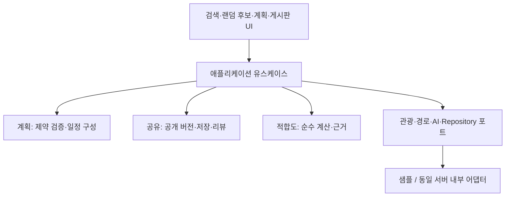

# 여행 코스 추천·공유 기능 설계

상태: **운영 설계 제안 / 당일 합성 샘플 구현** · 2026-10-02. 최초 설계 후 사용자 구현 요청으로 단계1~2 샘플을 추가했다. 운영 서버·DB·AI 호출은 아직 미구현이다. 기존 F104(여행계획), F110(공유게시판)을 보존하고 구체화는 CRS 요구사항으로 분리한다.

## 1. 제품 정의와 범위

사용자가 출발지·목적 지역·방문하고 싶은 장소 중 하나 이상을 제공하면, 필요한 조건을 보완하고 방문 순서·체류시간·이동 구간을 포함한 코스 초안을 만든다. 초안은 사용자가 수정한 후 명시적으로 게시한다. 다른 사용자는 공개 코스를 저장하거나 내 계획으로 복사할 수 있으며 리뷰와 별점을 남긴다. 시스템은 현재 여행 조건에 대한 개인 적합도를 별도로 계산한다.

| 서로 다른 개념 | 의미 | 변경 주체 |
| --- | --- | --- |
| 내 여행계획 Plan | 비공개, 수정 가능한 실제 일정 | 소유자 |
| 공유 코스 Course + Revision | 게시판에 공개한 코스와 불변 버전 | 작성자, 명시적 새 버전 게시 |
| 저장 SavedCourse | 공개 코스의 특정 버전을 내 저장함에서 참조 | 저장한 사용자 |
| 리뷰 Review | 사용자가 경험에 대해 작성한 글과 1~5 정수 별점 | 리뷰 작성자 |
| 리뷰 평균 | 공개 리뷰 별점의 산술 평균과 표본 수 | 시스템 집계 |
| 나와의 적합도 FitScore | 현재 조건과 코스 특성을 비교한 0~100 점수 | 버전이 있는 계산 정책 |

적합도는 만족할 확률·절대적 품질·인기도가 아니다. 같은 코스라도 조건이 다르면 달라진다. 조건이 없는 방문자에게 개인 점수를 만들어 보여주지 않는다. 리뷰 별점은 적합도 입력에서 제외해 인기 편향·중복 가산을 막는다. 작성자는 점수나 집계를 수정할 수 없다.

## 2. 사용자 시나리오와 최대 3단계 화면

| 시나리오 | 행동 | 결과 |
| --- | --- | --- |
| 출발지만 입력 | 코스 만들기 → 출발 지역 → 당일/시간·이동수단 입력 → 추천 | 이동 가능한 범위의 후보 초안, 목적지를 임의 확정하지 않음 |
| 목적지만 입력 | 목적 지역 → 여행시간·이동수단 입력 → 추천 | 지역 내 일정; 출발지 이동은 제외됐다고 표시 |
| 꼭 가고 싶은 장소가 있음 | 장소 선택 → 필수 방문 지정 → 추천 → 순서 변경 | 필수 방문을 보존한 일정, 불가능하면 이유와 변경 제안 |
| 랜덤 여행에서 발견 | 후보함 → 코스 만들기 | 지역 참조를 조건에 추가; 지역을 방문 장소로 오인하지 않음 |
| 관광지 검색 중 발견 | 장소 카드 → 일정에 추가 | 선택한 비공개 계획 또는 새 계획에 추가, 공개되지 않음 |
| 다른 사람 코스 활용 | 코스 둘러보기 → 상세 → 저장 / 내 일정으로 복사 | 저장은 원본 버전 참조, 복사는 독립 비공개 초안 |
| 내 코스 공유 | 내 여행 → 계획 편집 → 공개 미리보기 → 게시 | 개인 출발지 제거 확인 후 불변 공개 버전 생성 |
| 여행 후 평가 | 공개 코스 상세 → 리뷰 작성 | 별점·글 등록, 자신이 경험한 코스 버전 명시 |
| 나에게 맞는지 확인 | 코스 상세 → 여행 조건 수정 | 코스는 동일하고 개인 적합도·근거만 재계산 |

탐색 구조: 홈(1) → 여행지 탐색 / 랜덤 여행 / 코스 둘러보기 / 내 여행(2) → 코스 상세 또는 계획 편집(3). 기존 지역 관광정보도 3을 유지한다. 내 여행의 계획·지역 후보·저장 코스는 같은 화면 탭이다. 기존 #candidates는 내 여행의 지역 후보 탭으로 호환 연결할 계획이다. 상세에서 복사는 동일 깊이의 계획 편집으로 이동한다. 편집기의 조건·일정·공개 미리보기는 같은 화면 상태이며 하위 페이지를 만들지 않는다. 리뷰 입력은 상세 인라인 영역이다. 계정 대화상자 위 추가 대화상자를 띄우지 않는다.

기능이 늘어나는 공통 메뉴는 모바일에서 두 줄 또는 독립 메뉴 패널로 배치하고 모든 항목을 키보드로 접근 가능하게 한다. 메뉴 패널은 탐색 계층을 추가하지 않는다. 현재 위치·복귀 경로·제목 초점·수정 이탈 확인을 제공한다. 로딩/빈 결과/불완전 초안/실패/재시도를 각각 표시한다.

## 3. 설계 원칙과 적용 근거

- **도메인 경계·단일 책임**: 계획은 방문 순서와 시간의 일관성, 게시판은 공개 버전과 권한, 리뷰는 작성·집계, 적합도는 계산과 근거만 책임진다. 모듈은 같은 모놀리스 내부에 두며 서비스별 배포·메시지 브로커를 도입하지 않는다.
- **의존성 역전**: 일정·점수 계산은 순수 로직으로 테스트한다. 관광정보·길찾기·AI·저장소는 명시적 함수 계약으로 주입한다. SDK·HTTP 형식은 어댑터에서 내부 형식으로 변환한다.
- **불변 스냅샷과 명시적 상태 전이**: 공개 버전 수정 금지, 새 버전 게시만 허용. 저장과 리뷰는 버전을 참조한다. 개인 초안 저장과 공개 게시를 분리한다.
- **서버가 권한·점수의 권위**: 요청의 userId·작성자·score를 신뢰하지 않는다. 인증 세션과 대상 소유권을 매 요청 검사한다. 페이지 버튼 숨김은 권한 통제가 아니다.
- **설명 가능한 초기 추천**: 명시적 여행 조건과 장소 특성으로 시작한다. 상호작용 데이터가 없는 상태에서 협업 필터링을 도입하지 않는다. AI는 후보 생성/설명을 보조하며 가격·경로·점수를 확정하지 않는다.
- **YAGNI와 점진적 확장**: 범용 추천 프레임워크·벡터DB·실시간 피드·개인 추적·소셜 그래프·사진 업로드는 첫 범위에 넣지 않는다. 현재 필요한 포트만 설계한다.

근거: [Microsoft 도메인/애플리케이션 계층 분리](https://learn.microsoft.com/en-us/dotnet/architecture/microservices/microservice-ddd-cqrs-patterns/ddd-oriented-microservice)의 책임 분리만 적용하며 마이크로서비스 배포는 채택하지 않는다. [Google 콘텐츠 기반 추천](https://developers.google.com/machine-learning/recommendation/content-based/basics)은 명시적 특성 기반 초기 방식의 근거다. [OWASP 객체별 권한 검사](https://owasp.org/API-Security/editions/2023/en/0xa1-broken-object-level-authorization/)는 모든 계획·게시글·리뷰 ID 접근에 적용한다. 아래 숫자 정책은 이 자료가 정한 표준이 아니라 프로젝트 초기 제안값이다.

## 4. 모듈과 기존 기능의 연결

| 기존 자산 | 연동 설계 | 금지 사항 |
| --- | --- | --- |
| Catalog.list/preview, Place | PlaceRef를 통해 확장 관광 조회 포트로 재조회 | 시도 최대20개 preview를 전국 후보 전체라고 표시 금지 |
| 지역 후보함 | RegionRef(KOSTAT2013+id) → 명시적 TourAPI 지역 매핑 → 장소 후보 | KOSTAT 코드와 TourAPI 코드 혼용, 과거 경계를 최신 경계로 간주 금지 |
| 검색 카드 | 검증한 PlaceRef를 draft stop에 추가 | 현재 화면 문자열만으로 장소 식별 금지 |
| Kakao MapView | 코스 방문 순서·마커 표시와 외부 길찾기 연결 | 지도 SDK가 교통별 경로/소요시간을 제공한다고 가정 금지 |
| 회원 | sample 합성 사용자 → 후속 서버 세션 어댑터 | 로컬 회원 ID를 운영 인증으로 인정 금지 |
| Assistant.recommend | 기존 미연결 계약은 유지, 새 CourseGenerator 포트 별도 도입 | 기존 호출자 반환형을 몰래 교체 금지 |
| Logger | 기본 허용 이벤트 유지, 확장 시 허용 목록/제외 테스트 선행 | 여행 입력·좌표·리뷰·프롬프트·사용자 ID 원문 기록 금지 |

실제 다중 사용자 공유는 서버 인증·DB·인가가 필요하다. 브라우저 로컬 샘플은 합성 작성자의 게시판 데모일 뿐 다른 기기/사용자와 공유되지 않는다. 후속 서버는 현재 앱과 같은 배포 단위에 구성한다. 기존 후보함 자동 업로드는 하지 않고 로그인 후 선택한 항목만 멱등 import한다.

## 5. 추천·일정 구성 절차

1. 입력 정규화: 출발지/목적 지역/희망 장소 중 하나 이상. 원문 지명은 후보 검색 후 사용자가 확인하여 참조로 확정한다. 여행일 또는 날짜 미정, 일별 가용 시간과 이동수단이 있어야 시간 포함 추천을 실행한다. 출발지만 있으면 최대 이동시간을 추가로 받는다.
2. 후보 조회: 필수 방문, 목적 지역, 취향 조건을 반영한다. 페이지 제한·조회 범위·누락·갱신 시점을 반환한다. 빈 후보면 조건 변경을 제안한다.
3. 하드 제약 검증: 필수 방문/회피 장소, 확인된 이동·체류 시간, 확인된 휴무, 명시적 상한 예산. 알 수 없는 값은 만족으로 처리하지 않는다.
4. 기본 생성: 필수 장소 먼저 배치, 검증 가능한 후보를 가까운 삽입 방식으로 추가, 가능한 순서 변경만 평가한다. 후보/정렬 tie는 ID로 고정한다. 최적 경로 보장 문구는 쓰지 않는다.
5. 일정 검증: 겹침, 이동시간, 영업시간과 날짜, 출발·도착 조건을 재검증한다. 확인 불가 제약이 있으면 incomplete. 불가능하면 infeasible와 제약 완화 제안을 반환하고 자동 완화하지 않는다.
6. 점수·설명: 동일 평가기로 생성 코스와 게시판 코스를 평가한다. 사용자 수정 시 영향을 받는 구간과 점수를 무효화하고 재계산한다.
7. 결과는 비공개 초안. 저장·공개는 각각 사용자 동작이다. 생성 요청 취소나 실패로 공개/저장이 발생하지 않는다.

첫 제한 제안: 최대7일, 하루8개/전체40개 장소, 추천3개, 평가 후보100개. 과대 입력은 조용히 자르지 않고 VALIDATION_ERROR를 반환한다. 더 넓은 범위는 성능 측정 후 상한 정책 버전을 올린다. 날짜 미정은 영업 여부 확인 불가로 표시한다. 실제 길찾기 공급자가 없으면 방문 순서 초안만 제공하며 직선거리를 도로 이동시간으로 변환하지 않는다.

## 6. 개인 적합도 정책 v1 (보정 전 제안)

조건은 '지속 취향 프로필'보다 '이번 여행 조건'을 우선한다. 미입력값은 동의 없이 추론하지 않는다. 초기 차원은 관심사, 이동 부담, 여행 속도, 예산이다. 사용자 중요도는 low=1/normal=2/high=3, 미설정은 normal이다. 기본 동일 중요도는 근거 없는 우선순위를 줄이기 위한 제안이며 실험으로 보정한다.

| 차원 | 활성 조건 / 측정값 | 0~1 점수 |
| --- | --- | --- |
| 관심사 | 선호 태그가 있고 모든 방문지의 분류가 확인됨. m=선호 태그와 하나 이상 겹치는 방문 수, n=방문 수 | m/n; 출발·복귀 지점 제외, 태그 개수로 중복 가산 안 함 |
| 이동 부담 | 허용 이동시간 b>0, 모든 이동 구간의 검증된 시간 합 t | t<=b: 1, b<t<2b: 2-t/b, t>=2b: 0 |
| 여행 속도 | 선택한 일별 방문 수 허용구간 [l,u], 날짜별 방문 수 n_d | 날짜별 n_d가 구간 내면1, 아니면 max(0,1-distance(n_d,[l,u])/max(u,1)); 일 평균 |
| 예산 | 목표 예산 b>0, 동일 통화·인원 기준의 비용 구간 [low,high]이 완전함 | 이동 부담 함수에 t=high 적용; 비용 항목 누락이면 unknown |

하드 상한(반드시 지킬 최대 예산/시간)과 위 선호 기준을 별도 필드로 둔다. 하드 제약을 위반하면 점수로 상쇄하지 않고 ineligible, score=null이다. 제약 검증 불가이면 incomplete, 확정 점수=null이다.

활성 차원 중 검증된 차원만 K, 활성 전체 A라 한다. coverage=Σw(K)/Σw(A). suggested threshold=0.75. 충분한 정보일 때 score=round(100×Σ(w_i×s_i)/Σw_i). 활성 차원 최소2개, coverage>=0.75, 하드 제약 검증 완료일 때만 ready/정수 점수를 제공한다. 나머지는 insufficient_data/score=null과 missingFields를 제공한다. 비활성 차원은 분모에 넣지 않으며, 미확인은0점이 아니다. 일부 차원 제외로 점수가 부풀 수 있으므로 coverage와 비교 그룹을 반드시 표시한다.

예: 관심사0.8·이동1·속도0.5·예산0.9, 동일 가중치, 모든 제약 확인 → 80점. 예산만 unknown이면 coverage75%, 나머지 점수77점·'예산 제외'. 예산이 하드 상한으로 지정되어 있으면 위 계산 대신 incomplete로 표시한다. 개인 입력이 없으면 점수 미제공. 80점은 만족 확률80%가 아니다.

평가 응답에 policyVersion, courseRevisionId, 조건 지문, 데이터 스냅샷 버전, generatedAt/expiresAt, 항목별 score·weight·관측값·근거·missingFields를 포함한다. 동일 입력/정책/스냅샷은 동일 결과다. 캐시는 사용자 범위로 격리하며 지문을 인증 토큰으로 쓰지 않는다. 다른 조건·정책·활성 차원·확인 차원 조합은 같은 순위표에서 비교하지 않는다. 조건이 달라지거나 데이터가 갱신되면 stale 처리한다. 초기 만료24시간은 제안이며 영업시간/경로 공급자의 더 짧은 유효기간이 있으면 그 값을 따른다.

리뷰 평균은 별도 ratingSummary={average,count,distribution,revisionId}; 리뷰0개면 average=null. 수정은 delta 반영, 삭제·숨김 리뷰는 제외한다. 본인 코스 리뷰 불가. 유저당 코스1개 리뷰만 유지하며 수정 시 경험한 revisionId를 명시적으로 바꾼다. 버전별 집계와 전체 코스 집계를 구분하고 기본 표시는 현재 버전이다. 방문 확인은 현재 지원하지 않아 '방문 인증'이라고 표시하지 않는다.

## 7. 저장·게시·수정·삭제의 의미

Plan(draft) → 게시 트랜잭션 → Course(published)+CourseRevision(불변). 초안을 고쳐도 공개본은 그대로다. 재게시하면 revisionNumber 증가, activeRevisionId 교체. 게시 후에도 내 초안은 남는다. 동시 수정은 version/If-Match로 충돌 검출하며 덮어쓰지 않는다.

저장은 user+course 유일, savedRevisionId 고정. 원본 새 버전이 있으면 배지와 변경 비교를 제공하고 명시적 업데이트만 수행한다. 복사는 현재 권한으로 볼 수 있는 공개 스냅샷에서 새 Plan을 만들고 sourceCourseId/sourceRevisionId만 출처로 남긴다. 복사자가 출처 작성자의 소유권을 얻지 않는다. 리뷰와 점수는 복사하지 않는다. 순서만 바꿔도 새 계획 점수는 재계산한다.

게시 취소(unpublished)는 새 열람·저장·리뷰를 중지하며 저장함에는 이용 불가 카드만 남긴다. 삭제(deleted)는 복구 없는 UI 동작이며 서버 보존정책에 따라 본문/리뷰를 제거한다. 이미 개인 계획으로 복사한 공개 장소 일정은 유지하되 원문 후기·저자 개인정보·설명은 복사하지 않아 철회 위험을 줄인다. 원본 비공개/삭제 시 출처 링크는 이용 불가로 표시한다. CDN·검색·집계 캐시도 무효화하고 직접 revision URL로 우회 노출하지 않는다.

## 8. 개인정보·운영 경계

정밀 출발지/도착지와 여행 날짜는 비공개 Plan 입력으로 취급한다. 공개 CourseRevision은 별도 허용 목록 DTO에서 생성한다. 공공 관광지·체류시간·방문 순서만 기본 공개하고 집 주소·정밀 개인 지점·이메일·비공개 메모·개인 조건/적합도는 배제한다. 설명/리뷰 자유문은 자동으로 개인정보가 제거된다고 보장하지 않으며 게시 미리보기와 수정/신고/삭제 경로를 제공한다.

서버 도입 전 승인할 초기 보존안: 생성 입력은 요청 동안만 메모리 유지, 사용자가 저장한 개인 계획은 삭제까지 보관, 삭제된 사용자 콘텐츠는 활성 저장소에서24시간 내 제거, 백업 최대30일 후 만료. 보안 감사 기록은 콘텐츠 없는 허용 이벤트만30일. 계정 탈퇴는 게시물 비공개·개인 계획/저장/프로필/리뷰 삭제·집계 재계산을 하나의 삭제 작업으로 추적한다. 실제 운영 정책/약관 확정 및 삭제 검증 전 실 개인정보를 수집하지 않는다.

공개 게시·리뷰에는 서버 인증, 객체 권한, 요청 제한, HTML 안전 출력, 신고/관리자 숨김, DB 트랜잭션이 필요하다. 공급자 키는 서버 전용, live 명시 활성화만 사용한다. sample UI는 공유된 것처럼 오인시키지 않는다.

## 9. AI 확장 방식

1단계: 규칙 기반 CourseGenerator로 계약을 검증. 2단계: 동일 포트의 AI 생성기로 후보 방문 순서만 제안. 3단계: 충분한 동의 기반 평가자료 확보 후 개인화 모델을 별도 버전으로 평가. AI를 넣는 것만으로 정확도가 개선됐다고 간주하지 않는다.

AI에는 서버가 허용한 장소 ID·검증된 요약 특성·최소화된 여행 조건만 전달한다. 집 좌표·계정 ID·리뷰 원문·자유문 입력은 기본 제외한다. 자연어 파서가 추가되면 조건 후보를 반환하고 사용자 확인 후 반영한다. 외부 설명/리뷰는 명령이 아닌 데이터로 처리한다. 모델이 반환한 장소 ID, 시간, 필수 방문, 범위를 검증하고 유효하지 않으면 폐기한다. AI가 장소/영업시간/별점/적합도를 생성해 사실로 저장할 수 없다. 공개·삭제·결제 같은 도구 권한을 주지 않는다.

timeout/cancel/형식 오류/공급자 장애 시 기본 생성기로 대체 가능한 경우 fallback을 명시하고 결과를 반환한다. 대체 불가능하면 unavailable. 생성 공급자·모델/정책 버전·입력 데이터 스냅샷·검증 결과를 콘텐츠 없는 메타데이터로 유지한다. 프롬프트 원문은 일반 로그에 저장하지 않는다. 배포 전 같은 fixture에서 제약 위반율·존재하지 않는 장소율·지연·비용·수정률을 비교하며 하드 제약 위반과 허위 장소 허용치는0이다.

## 10. 단계별 개발과 결정 필요 사항

1. **계약/순수 로직**: CRS 수용 테스트 작성 → 기본 생성·검증·점수 계산. 합성 fixture만 사용, AI 없음.
2. **프론트 샘플**: 내 계획·게시판·저장·리뷰 시나리오와 기존 후보함/검색 연결. 3단계·접근성·빈 결과·취소 검증.
3. **동일 모놀리스 서버**: 서버 인증/DB/권한·공개 DTO·트랜잭션·삭제/신고 정책 검증. 이 단계가 끝나야 실제 다중 사용자 공유 가능.
4. **실 관광·경로 연동**: 제공 범위와 사용 조건을 확인한 공급자 연결. 출발지와 교통별 경로를 실측 검증. Kakao 지도와 경로 제공자는 독립적이다.
5. **AI 선택 도입**: 동일 인터페이스와 검증기를 통과한 뒤 명시적 AI 모드 제공.

구현 전 제품 선택: 첫 출시 여행 범위(당일 우선 권장/다일), 지원 이동수단(실 경로 공급자 확보 기준), 점수 중요도·coverage 임계값 보정, 리뷰/신고 운영 담당·보존정책. 본 문서의 제한·수식은 구현 가능한 제안 기본값이며 사용자 확정으로 위장하지 않는다. 개발 착수 시 결정된 값은 정책 버전과 ADR에 고정한다.

연결 문서: [인터페이스 계약](../specs/course-interfaces.md), [수용 기준](../specs/features/course-recommendation.md).

## 입력 최소화 개선 (UX-CRS-01~04)

첫 화면은 목적 지역만 선택한다. 랜덤 후보·검색 장소에서 넘어오면 선택값을 재사용한다. 제목은 자동 생성하고 결과에서 변경한다. 상세 조건과 필수 장소는 접힌 선택 영역, 순서·체류시간·삭제는 '일정 편집'에서 제공한다. 공유 상세의 조건은 '나에게 맞게 조정'에서만 표시하고 현재 체험 사용자의 세션 조건을 재사용한다. 체험 사용자 변경 시 조건을 초기화한다.

기본 예산5만원·문화 선호·여행 속도를 사용자 취향으로 간주하던 동작을 제거했다. 미입력 값은 null/빈 배열이며 기본 코스에는 개인 점수를 표시하지 않는다. 과거 저장본은 선호 입력 출처가 없으면 기존 조건을 개인 점수로 사용하지 않고 편집 진입 시 보수적으로 초기화한다. 사용자가 현재 폼에서 설정한 조건만 explicitPreferences=true로 관리한다. 시간540~1080은 일정 구성의 가정이며 취향 점수 입력이 아니다.

근거: [NN/g Progressive Disclosure](https://www.nngroup.com/articles/progressive-disclosure/), [GOV.UK 질문 필요성·조건부 질문](https://www.gov.uk/service-manual/design/form-structure). 본 구현은 원칙을 적용한 제품 선택이며 사용자 실험의 효과 측정은 아직 하지 않았다.
